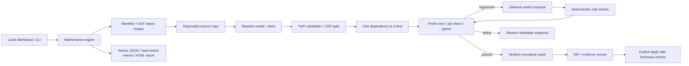

# DepGraph

**Dependency upgrades that earn their way into your codebase.**

DepGraph is a local Python dependency maintenance workbench. It establishes a passing baseline, evaluates upgrades in disposable workspaces, gates candidates on security policy, and produces verified patches for review. Optional Gemini diagnosis can propose small compatibility repairs; deterministic checks and another test run decide whether they survive.

The dashboard connects import impact, upgrade decisions, subprocess evidence, and source diffs. The CLI uses the same engine.

## Start in two minutes

Python 3.11+ with `venv` and `pip` is required.

```powershell
py -3 -m venv .venv
.\.venv\Scripts\python.exe -m pip install -e ".[dev]"
.\.venv\Scripts\python.exe -m depgraph serve
```

Open **http://127.0.0.1:8080** and select **Run offline demo**.

On Linux/macOS, use `python3 -m venv .venv`, then `.venv/bin/python` in place of the Windows executable. After activating the environment, all examples below work as written.

```bash
python -m depgraph demo
```

The offline fixture executes four real unittest contracts against local API versions:

| Package | Change | Verified outcome |
| --- | --- | --- |
| responsekit | 1.0.0 → 2.0.0 removes a float alias | Failure diagnosed by an explicit fixture rule; source repaired; tests pass |
| formatkit | 1.0.0 → 1.1.0 preserves its API | Clean upgrade; tests pass |
| guardkit | 1.0.0 → 2.0.0 changes authorization behavior | Contract fails; candidate rolled back |

**Demo results are labeled fixture data.** The demo does not query PyPI/OSV, invoke Gemini, or install these fictional packages. Its tests actually run in subprocesses against versioned local modules. Demo patches cannot be applied to real projects.

## Analyze a real project

Supported input: a Python repository with a root `requirements.txt` containing exact `name==version` pins and a pytest-compatible test suite. Extras, environment markers, and inline comments are preserved. Ranges, editable installs, URLs, recursive includes, wildcard pins, and duplicate packages fail explicitly.

```bash
python -m depgraph analyze /path/to/repository --trust-repo
```

`--trust-repo` acknowledges that installation hooks and tests execute code. Analysis keeps original source unchanged. Real validation creates a fresh virtual environment for every attempt, installs dependencies plus pytest, runs `pip check`, runs tests, and captures `pip freeze --all` on success.

Defaults exclude major upgrades, prereleases, yanked releases, interpreter-incompatible releases, vulnerable candidates, and candidates whose security lookup failed.

```bash
# Explicitly consider major upgrades
python -m depgraph analyze /path/to/repository --trust-repo --allow-major

# Explicitly permit an unavailable OSV result (known vulnerable versions remain blocked)
python -m depgraph analyze /path/to/repository --trust-repo --allow-unknown-security

# Enable the dashboard for exactly one trusted repository
python -m depgraph serve --repo /path/to/repository --trust-repo
```

Versions are selected for the interpreter running DepGraph. PyPI metadata compatibility is preliminary; pip installation establishes whether an actual distribution can be installed on the current platform.

## Review, export, apply

```bash
python -m depgraph show RUN_ID
python -m depgraph report RUN_ID --output execution-report.html
python -m depgraph apply RUN_ID
```

Run JSON artifacts live in `.depgraph/runs/` by default. Use the global `--state PATH` option **before** the subcommand to use another directory. The dashboard exports the full JSON evidence bundle; the report command generates a portable, self-contained HTML report.

Apply is separate from analysis. It verifies event integrity, the patch digest, the complete source inventory, allowed paths, and exact file preimages. A repository lock prevents concurrent DepGraph applies. Files are replaced individually; caught apply failures restore the original bytes. This is not an atomic multi-file filesystem transaction: abrupt power loss or process termination during apply requires manual recovery from the stored `before` contents and inspection of `.depgraph/apply.lock`.

## Optional AI repair

```bash
python -m pip install -e ".[ai]"
```

Set `DEPGRAPH_ENABLE_AI=1`, `GEMINI_API_KEY`, and `DEPGRAPH_MODEL` in your environment to explicitly enable a model available to your account. No model name is assumed. Gemini receives the selected application's source and redacted failing test output; enable it only when you accept sending that content to the provider. Source containing recognized credential patterns is rejected before a request. Never put credentials in source control.

Repairs are attempted only after a passing baseline, successful installation, and a test-stage regression. At most three importing application files are considered, one proposal per file. Tests are protected. Proposed changes must match a unique source span, parse as Python, preserve assertion count, and avoid adding exception handlers. Failed proposals are reverted. These checks constrain edits; they do not prove semantic correctness or make generated code trustworthy. Without configured AI, a failing real upgrade is rolled back.

## Architecture



The AST graph maps source imports to declared dependencies. It is **not** a full transitive dependency graph. Resolved environment versions are captured separately by pip. Risk scores are explainable heuristics, not probabilities. Candidates are evaluated sequentially against the previously accepted workspace state.

## Engineering checks

```bash
python -m pytest -q
python -m ruff check depgraph tests
python -m ruff format --check depgraph tests
python -m depgraph demo
```

Tests cover actual fixture execution, baseline gating, installation failure classification, security defaults, rollback, stale-source rejection, patch/event tampering, partial apply failure, parser edge cases, real command timeouts, escaped reports, HTTP origin/token checks, and async run persistence. CI is configured for Python 3.11–3.13 on Windows and Linux; local results are documented in [validation.md](docs/validation.md).

## Container demo

```bash
docker build -t depgraph .
docker run --rm --network none depgraph
```

The image runs the offline CLI demo as a non-root user. Container build needs access to the Python package registry. The local workbench intentionally binds to loopback; this is not a public SaaS deployment.

## Scope and trust

This release is a single-user local developer tool. Disposable copies and virtual environments isolate source changes and dependencies; **they do not sandbox malicious code**. Run only trusted repositories on the host. Host filesystem and network access remain possible from target execution. Common credential environment variables and `.env`, `.key`, and `.pem` files are omitted from execution, but this is not a complete secret isolation mechanism.

Target commands receive an allowlist of system variables, not the parent application's credential environment. Pip user configuration is disabled, and target installation requires wheels from PyPI; packages available only as source distributions fail closed. Before committing, run `python scripts/scan_secrets.py` to scan staged contents and `python scripts/scan_secrets.py --history` to scan reachable history. Enable the local guard with `git config --local core.hooksPath .githooks`. See [SECURITY.md](SECURITY.md) for privacy controls and remaining limits.

OSV is checked for direct upgrade candidates; transitive vulnerability auditing, lockfile generation with artifact hashes, multi-language manifests, hostile-code container execution, distributed workers, and automatic PR publication are not implemented. Hash-linked logs detect accidental edits relative to the stored chain; an actor who can rewrite the whole artifact can regenerate hashes. Current run history loads complete artifacts and is intended for local project scale.

See [architecture and tradeoffs](docs/architecture.md), [the interview demo guide](docs/demo-guide.md), and [validation evidence](docs/validation.md).

The original hackathon implementation remains under `agent/` as historical reference. Its previous README, including the architecture diagram added before this rebuild, is preserved in [legacy-prototype.md](docs/legacy-prototype.md). Use the `depgraph` package and commands above for current development; the legacy HTTP server is not the supported entrypoint.
