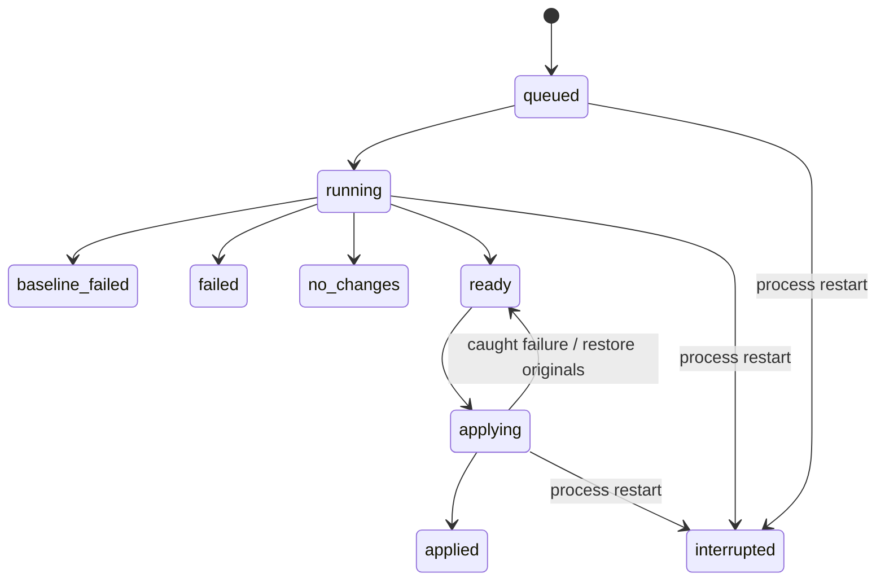

# Architecture and design decisions

DepGraph separates decision-making from authority to change the source repository. The current implementation is a local workbench, with one server worker and JSON artifacts rather than a distributed service.

## Execution boundaries

`project.py` parses exact requirements pins and builds AST import edges. The manifest rejects syntax the engine cannot preserve faithfully. Package names use Python packaging normalization; a small explicit alias table handles common differences between import and distribution names. Dynamic imports, namespace packages, and undeclared transitive imports are not inferred.

`Engine.create` captures input hashes, policy, interpreter version, and the impact graph. `Engine.run` copies regular files into a disposable directory, verifies input freshness, and establishes a passing baseline. Every candidate runs against the cumulative accepted workspace state, so later tests include earlier accepted upgrades.

`Registry` selects stable, non-yanked PyPI releases with compatible Python metadata. The default policy stays within the installed major version. Candidate OSV results have three distinct states: clear, vulnerable, and unknown. A network error becomes unknown and blocks by default. A clear result means no known advisory was returned for that direct candidate at lookup time; it is not a supply-chain security guarantee.

`VenvRunner` creates a fresh environment per validation. Its sequence is environment creation, dependency installation, `pip check`, pytest, and a resolved-version inventory. Stage and exit code remain separate, so a resolver error, timeout, or environment failure cannot become an application repair request. Pytest's no-tests-collected exit is a failed validation. Commands use argument arrays without a shell. Output is spooled to disk and only the last 24 KB per stream enters the artifact. Commands have time budgets and timeout cleanup targets process groups on Unix and the process tree on Windows.

Target subprocesses receive an allowlist of system variables. Pip uses an explicit PyPI index and requires binary wheels, with user pip configuration disabled. Known secrets and exact credential-environment values are redacted from captured output. AI requires a separate `DEPGRAPH_ENABLE_AI=1` opt-in and rejects source with recognized secret patterns. These protections reduce accidental exposure and source build hooks; they do not isolate target code from the host or prevent every form of secret disclosure.

`repair.py` is a constrained proposal interface. An optional Gemini provider receives one importing application file and failure output. It returns a source span and replacement, never filesystem authority. The engine chooses the file, checks unique matching and Python syntax, rejects assertion removal and additional exception handlers, protects test files, and runs a fresh validation. Each validation rejects changes to its input files, preventing a self-modifying test from manufacturing an accepted patch. This is defense against mistakes in trusted projects, not a hostile-code security boundary.

## Run lifecycle

The server marks unfinished records interrupted when starting. Interrupted does not imply an upgrade succeeded or an apply was restored. Analysis can always be rerun because it does not write source. Interrupted applies require inspection using the run's stored preimages.

## Review and apply

The accepted patch contains exact before/after text and unified diffs. Apply checks the patch digest, event links, source inventory, per-file preimage, and allowed target paths before writing. An exclusive repository lock coordinates DepGraph writers. A caught error restores backups. Individual replacements are atomic, but a multi-file patch is not atomic under power loss or forced termination. External editors do not respect DepGraph's lock, so users should avoid editing during apply; checks reduce stale-write risk but are not a general filesystem transaction protocol.

## Evidence and storage

Each event includes a sequence, UTC timestamp, stage, previous hash, and SHA-256 of its canonical JSON body. Run files are written through a unique sibling temporary file, flushed, and atomically replaced. Windows sharing violations receive a short bounded retry. An in-process reentrant lock coordinates server readers and writers. Multiple independent servers should use different state directories.

Event linking detects modifications relative to the existing chain. It is not an authenticated audit log: someone with write access to the entire artifact can regenerate it. Commands, test output, chosen versions, policy decisions, repair provenance, and diffs remain available in JSON and escaped HTML reports. Artifacts can contain source and paths; treat them with the same care as repository content.

## HTTP boundary

The workbench binds to `127.0.0.1`. It accepts only the expected local Host, validates Origin for mutations, and requires a random per-process token obtained by the same-origin UI. GET requests do not execute workflows. The UI does not submit arbitrary repository paths: a real target must be configured at server startup with an explicit trust flag. One worker and a nonblocking operation lock reject overlapping maintenance requests with HTTP 409. CSP, escaped report content, and DOM text nodes constrain untrusted artifact rendering. This is not a replacement for authenticated, hardened hosting.

## Why these tradeoffs

- Local files and a standard-library HTTP service keep the demo installable with one required dependency. A database and queue become useful when retention, pagination, scheduling, or multiple workers are requirements.
- Exact pins avoid silently rewriting complex manifests incorrectly. Supporting pyproject/lockfiles requires dedicated manifest adapters and resolver semantics.
- An offline integration fixture guarantees a demonstrable failure/repair/rollback without depending on registry state or model behavior. It is conspicuously labeled and distinct from real validation.
- Fresh environments cost time but avoid contamination across attempts. Reusable dependency caches and container workers need explicit invalidation and trust boundaries.
- Human review remains a separate step. Passing tests narrow uncertainty; they do not prove application behavior, performance, or deployment compatibility.

## Next engineering extensions

Add a container execution backend with resource/network limits before accepting untrusted repositories. Add artifact hashes and lockfile adapters for stronger reproducibility. Resolve and audit transitive dependencies rather than presenting an import map as a full dependency graph. Add durable apply recovery, paginated storage, provider evaluations, and PR creation as separately tested capabilities. These are future extensions, not capabilities claimed by this release.
