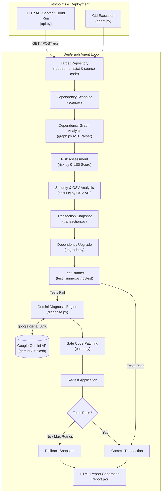

# DepGraph 🚀
> **Autonomous Dependency Upgrade & Self-Healing Agent for Google Cloud**
> Built for the *All Things Agentic Hackathon*.

DepGraph automatically scans Python repositories for outdated dependencies, evaluates upgrade risk & security vulnerabilities (via OSV), attempts automated upgrades in isolated transactions, diagnoses test failures using **Gemini**, applies safe code repair patches, and generates visual HTML execution reports.

---

## 🛠️ Key Features
- 🔍 **Dependency Graph & Usage Scanner**: Identifies used vs. unused packages and third-party imports (`graph.py`, `scan.py`).
- 🛡️ **Risk & Security Analysis**: Computes composite risk scores (0–100) and queries OSV for known CVEs (`risk.py`, `security.py`).
- 🔄 **Transactional Upgrade & Rollback**: Snapshots repository state before applying changes, committing on success or rolling back cleanly on failure (`transaction.py`).
- 🤖 **Gemini AI Diagnosis & Safe Patching**: Diagnoses breaking API changes on test failure and generates minimal code patches (`diagnose.py`, `patch.py`).
- 📊 **Static HTML Report Generation**: Exports self-contained execution reports (`report.py`).
- ☁️ **Cloud Run Ready**: Exposes a REST API (`api.py`) for containerized deployment on Google Cloud Run.

---

## 📐 Architecture & Workflow



---

## 💻 Local Setup & Prerequisites

### 1. Requirements
- Python 3.11+
- Google Gemini API Key (`GEMINI_API_KEY`)

### 2. Installation
```bash
git clone <repo-url>
cd depgraph
pip install -r agent/requirements.txt
```

### 3. Environment Variables
Set your Gemini API key in your environment (do **not** commit keys or `.env` files):

**Linux / macOS:**
```bash
export GEMINI_API_KEY="your-gemini-api-key-here"
```

**Windows (PowerShell):**
```powershell
$env:GEMINI_API_KEY="your-gemini-api-key-here"
```

---

## 🚀 Running DepGraph

### Option A: CLI Execution
Run DepGraph directly against any target Python repository (e.g. `target-repo`):

```bash
python agent/agent.py target-repo
```

### Option B: Local HTTP API Server
Start the HTTP API server locally:

```bash
python agent/api.py
```
The server will start on `http://localhost:8080`.

#### API Endpoints
- **Health Check**: `GET /health`
  ```bash
  curl http://localhost:8080/health
  ```
  Returns `{"status": "healthy", "service": "depgraph-agent"}`

- **Trigger Workflow**: `POST /run` or `GET /run`
  ```bash
  curl -X POST http://localhost:8080/run
  ```
  Triggers DepGraph analysis on `target-repo`, performs upgrades/repairs, and generates `depgraph_report.html`.

- **View HTML Report**: `GET /report`
  ```bash
  curl http://localhost:8080/report
  ```
  Renders the generated execution report.

---

## ☁️ Google Cloud Run Deployment

Deploy DepGraph to Google Cloud Run as a stateless containerized service:

### 1. Build & Deploy with Google Cloud CLI
```bash
# Set your GCP Project ID
gcloud config set project YOUR_PROJECT_ID

# Deploy directly to Cloud Run from source
gcloud run deploy depgraph-agent \
  --source . \
  --region us-central1 \
  --allow-unauthenticated \
  --set-env-vars GEMINI_API_KEY="your-gemini-api-key-here"
```

### 2. Secret Manager Integration (Recommended for Production)
Store your API key in GCP Secret Manager:
```bash
gcloud secrets create GEMINI_API_KEY --replication-policy="automatic"
echo -n "your-api-key" | gcloud secrets versions add GEMINI_API_KEY --data-file=-

gcloud run deploy depgraph-agent \
  --source . \
  --region us-central1 \
  --allow-unauthenticated \
  --set-secrets GEMINI_API_KEY=GEMINI_API_KEY:latest
```

---

## 🧪 Hackathon Deterministic Fixture (`target-repo`)

The repository includes a deterministic demo target in `target-repo/`:
- **Outdated Package**: `numpy==1.23.5` (PyPI latest: `2.4.6`).
- **Code Pattern**: `app.py` uses `np.float(...)` (removed in NumPy 1.24).
- **Workflow Demonstrated**:
  1. DepGraph detects outdated `numpy`.
  2. Bumps `numpy` to `2.4.6`.
  3. Tests fail with `AttributeError: module 'numpy' has no attribute 'float'`.
  4. Gemini diagnoses breaking alias removal in NumPy 1.24.
  5. DepGraph applies code patch replacing `np.float` with Python `float`.
  6. Tests pass; transaction commits.
  7. `depgraph_run_log.json` and `depgraph_report.html` are generated.

---

## 🧪 Running Unit Tests

Run the full test suite (60 tests):

```bash
python agent/tests/test_api.py -v
python agent/tests/test_report.py -v
python agent/tests/test_graph.py -v
python agent/tests/test_agent_integration.py -v
python agent/tests/test_transaction.py -v
python agent/tests/test_risk.py -v
python agent/tests/test_security.py -v
```
